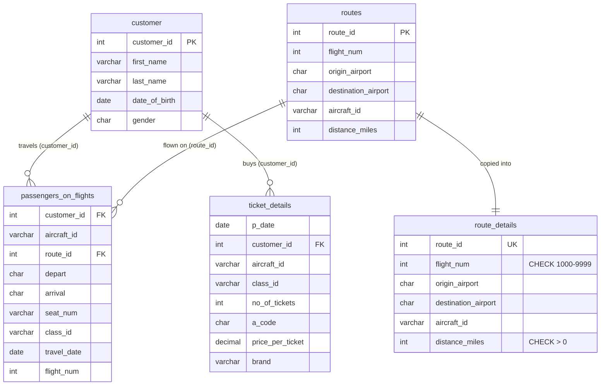

# Air Cargo Analysis (MySQL)

Reports for an aviation company on regular passengers, busy routes and ticket sales, built in MySQL 8 with constraints, window functions, ROLLUP, views, stored procedures/functions, indexes and a cursor.

**File:** [`air_cargo_analysis.sql`](air_cargo_analysis.sql) — one self-contained script (creates the `air_cargo` database, loads the four CSVs as `INSERT`s, then runs every task).

```bash
mysql -u root -p < air_cargo_analysis.sql
```

## ER diagram



## Tasks covered

| # | Task | Technique |
|---|------|-----------|
| 1 | ER diagram | Mermaid (above) |
| 2 | `route_details` table | CHECK (flight number, distance > 0), UNIQUE (route_id) |
| 3 | Passengers on routes 1–25 | BETWEEN + JOIN |
| 4 | Business-class passengers and revenue | Aggregates |
| 5 | Customer full name | CONCAT |
| 6 | Registered customers who booked | INNER JOIN |
| 7 | Emirates customers | JOIN + filter |
| 8 | Economy Plus travellers | GROUP BY + HAVING |
| 9 | Has revenue crossed 10,000? | IF() |
| 10 | New user with privileges | CREATE USER / GRANT |
| 11 | Max ticket price per class | Window `MAX() OVER` |
| 12–13 | Route 4 passengers, faster | INDEX + EXPLAIN / EXPLAIN ANALYZE |
| 14 | Ticket totals per customer & aircraft | GROUP BY … WITH ROLLUP |
| 15 | Business-class customers + brand | VIEW |
| 16 | Passengers in a run-time route range, error if table missing | Procedure + `EXIT HANDLER FOR 1146` |
| 17 | Routes > 2000 miles | Procedure |
| 18 | SDT / IDT / LDT distance categories | Procedure + CASE |
| 19 | Complimentary services (Business, Economy Plus) | Stored function called inside a procedure |
| 20 | First customer whose last name ends in "Scott" | Cursor |

## Key findings

- 50 customers, 50 flights, 50 ticket purchases across 49 routes.
- **Business class:** 11 customers bought 13 tickets for **6,034** in revenue.
- **Total revenue:** 15,369 — the IF check reports it **crossed 10,000**.
- **Route 4 (JFK→LAX):** customers 2, 4 and 11.
- **Cursor result:** Samuel Scott (customer 37) is the first "…Scott" record.

_Data note:_ the source data spells the class `Bussiness` and one brand as both `Bristish Airways` and `British Airways`. Queries use the values as they appear in the data.

> Change the demo password in Task 10 (`ChangeMe#2024`) before running on a shared server.
