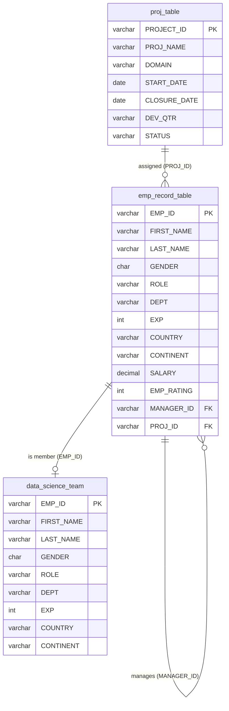

# ScienceQtech Employee Performance Mapping (MySQL)

HR reporting for a data-science start-up: employee details, ratings, reporting lines, salary bands, bonus cost and whether job titles match the company's experience standard.

**File:** [`employee_performance_mapping.sql`](employee_performance_mapping.sql) — one self-contained script (creates the `employee` database, loads all three CSVs as `INSERT`s, then runs every task).

```bash
mysql -u root -p < employee_performance_mapping.sql
```

> Prefer importing the raw CSVs? Use MySQL Workbench's *Table Data Import Wizard* or
> `LOAD DATA LOCAL INFILE '../1697127874_performance_mapping_datasets/emp_record_table.csv' INTO TABLE emp_record_table FIELDS TERMINATED BY ',' ENCLOSED BY '"' IGNORE 1 LINES;`

## ER diagram



## Tasks covered

| # | Task | Technique |
|---|------|-----------|
| 1 | Create `employee` DB and import 3 tables | DDL + INSERT, PK/FK constraints |
| 2 | ER diagram | Mermaid (above) |
| 3 | Employee list with department | SELECT |
| 4 | Ratings < 2, > 4, between 2 and 4 | WHERE / BETWEEN |
| 5 | Finance employees' full name as `NAME` | CONCAT |
| 6 | Employees with reporters + count | Self-join, GROUP BY |
| 7 | Healthcare + Finance employees | UNION |
| 8 | Details by dept with dept max rating | Window `MAX() OVER (PARTITION BY)` |
| 9 | Min / max salary per role | GROUP BY |
| 10 | Rank by experience | `RANK()`, `DENSE_RANK()` |
| 11 | View: salary > 6000 by country | CREATE VIEW |
| 12 | Experience > 10 years | Nested sub-query |
| 13 | Experience > 3 years | Stored procedure |
| 14 | Role vs. organisation standard | Stored function |
| 15 | Speed up `FIRST_NAME = 'Eric'` | EXPLAIN before/after + INDEX |
| 16 | Bonus = 5% × salary × rating | Calculated column |
| 17 | Avg salary by continent and country | GROUP BY + window |

## Key findings

- **Reporting lines:** the President (E001) has 5 direct reports; managers E083, E428, E583 have 3 each.
- **Low performers (rating < 2):** E057, E532, E620 — candidates for training.
- **Bonus cost:** highest bonuses go to E001 (4,125), E083 (2,375) and E428 (2,200).
- **Job-profile check:** every data-science team member's title matches the experience standard.

_Data note:_ `proj_table` mixes `MM-DD-YYYY` and `M/D/YYYY` dates and `emp_record_table` uses both `NULL` and `NA` for missing project IDs. Both were normalised (ISO dates, SQL `NULL`) in the load script.
